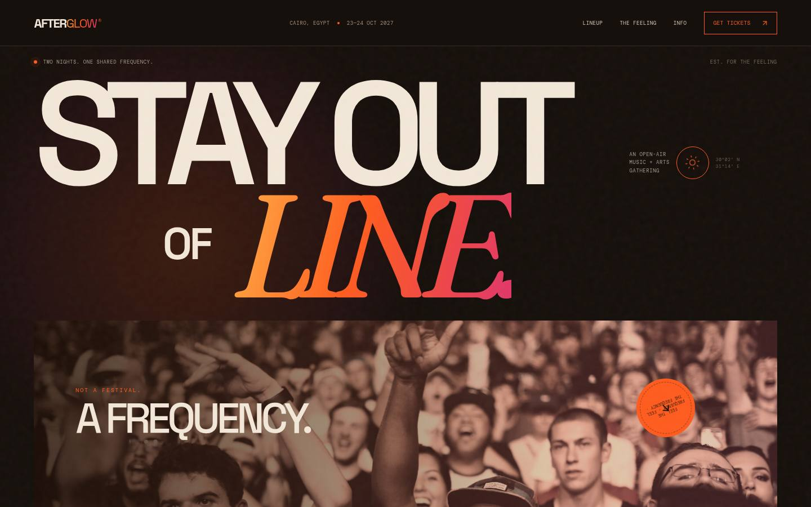
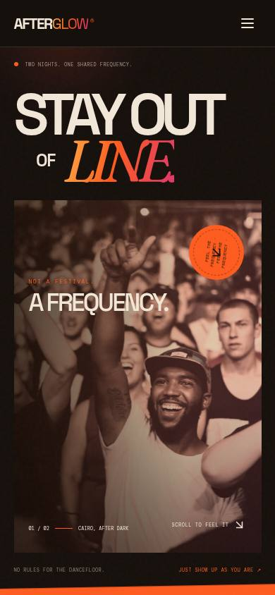
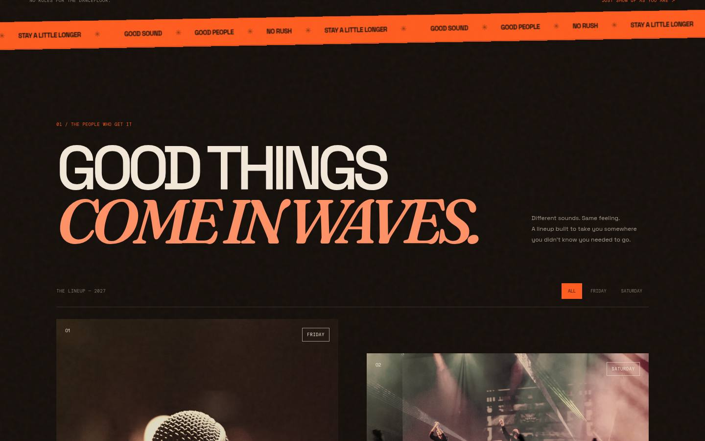

# AFTERGLOW — Music + Arts Festival Website

A responsive, motion-led festival microsite built with React and Vite. The art direction — **"Afterglow heat"** — is a warm sunset palette: deep warm black, sun-bleached cream type, ember-orange / coral / magenta accents, sunset gradients, Fraunces display italics, warm duotone photography, grain, and motion.

| Desktop | Mobile |
| --- | --- |
|  |  |



## Features
- Animated typographic hero with gradient display type and marquee ticker (pauses on hover)
- Scroll-triggered section reveals and hover treatments
- Artist lineup with day filters and warm duotone imagery
- Interactive Friday/Saturday running schedule with LIVE/DJ chips
- Responsive navigation for mobile
- Ticket selection modal with ticket-type choice, quantity selector, and calculated totals
- Demo reservation confirmation state
- Accessible dialog labels, button labels, semantic headings, visible focus states, and reduced-motion support

## Run locally

```bash
npm install
npm run dev
```

Open the local URL printed by Vite.

## Build

```bash
npm run build
npm run preview
```

## Important
This is a fictional portfolio concept for AFTERGLOW in Cairo. Ticket prices, schedule, event and location are sample content. The ticket modal is an interactive front-end demo only: it does not take payments, store personal information, or issue real tickets. Photography is loaded from Unsplash URLs and Google Fonts are loaded remotely.
